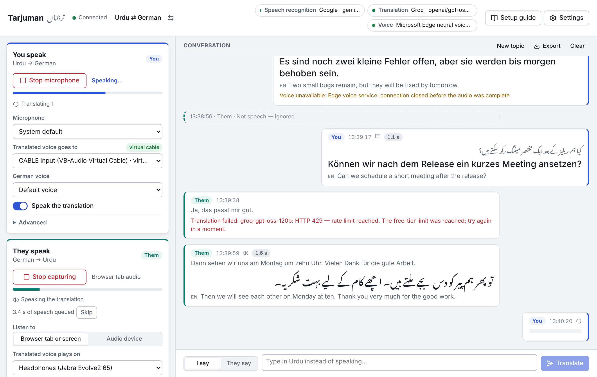
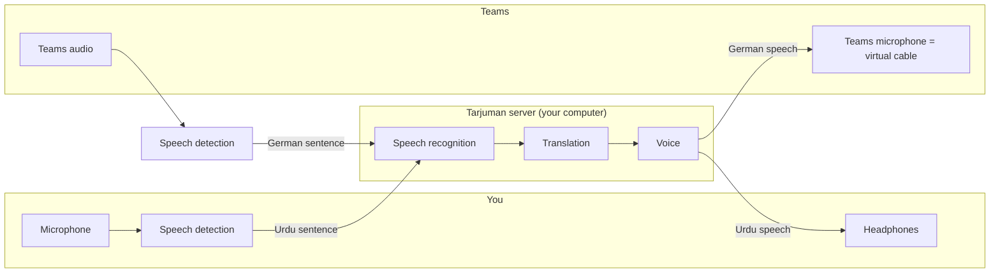

# Tarjuman · ترجمان

**A live voice interpreter for Microsoft Teams calls.** You speak Urdu, the other side
hears German. They speak German, you hear Urdu. Everything is also shown as captions,
with English alongside. It runs on free tiers; nothing to pay for a proof of concept.



- **Two directions at once.** Your microphone is interpreted into a virtual microphone
  that Teams listens to; the call's audio is interpreted into your headphones.
- **Accuracy first.** Urdu is heard by a multimodal model that transcribes and translates
  in one step, with the conversation so far, a glossary of your names and terms, and the
  right form of address ("Sie" / "آپ").
- **Built for free tiers.** Every step has several providers behind an automatic fallback
  chain, so a rate limit on one does not interrupt the call.
- **Only the people who want it need it.** It runs on your computer next to Teams. The
  other participants install nothing.

> **Status: proof of concept.** The pipeline, the browser audio engine and the interface
> are covered by automated tests, including a real browser listening to recorded speech,
> and the keyless voice and translation paths were run against the real services. What
> could not be exercised where this was built is anything that needs an API key (speech
> recognition and the LLM translators) and a real Teams call. Run `npm run doctor` after
> adding your keys: it tests every provider and tells you exactly what works. See
> [What has and has not been verified](#what-has-and-has-not-been-verified).

## Quick start

You need [Node.js 22](https://nodejs.org) or newer and Chrome (or Edge) on a computer.

```bash
npm install
npm run build
npm start
```

Open **http://localhost:8787**.

1. **Add a free key.** Settings → API keys. Paste a [Groq key](https://console.groq.com/keys)
   (speech recognition, required) and a [Google AI Studio key](https://aistudio.google.com/apikey)
   (best Urdu accuracy, recommended). Neither needs a credit card. Press **Test providers**.
2. **Try it without Teams.** Press **Start microphone**, say a sentence in Urdu, pause.
   The German translation appears and is spoken through your speakers. Typing in the box
   at the bottom works too, even before you have any key.
3. **Connect it to Teams.** Open the **Setup guide** in the app, or read
   [docs/TEAMS-SETUP.md](docs/TEAMS-SETUP.md). In short: install a virtual audio cable,
   choose it under "Translated voice goes to" and as the microphone in Teams, and let
   Tarjuman listen to the Teams tab.

Check the whole setup from the command line at any time:

```bash
npm run doctor
```

## How it works



The browser listens, and a small neural network (Silero VAD, running locally) decides
where each sentence ends. Only speech leaves your computer. The server sends each sentence
to speech recognition, translation and a neural voice, and the result is played to the
right device: the virtual microphone for what you said, your headphones for what they said.
A sentence is typically interpreted one to three seconds after you finish it.

Details: [docs/ARCHITECTURE.md](docs/ARCHITECTURE.md).

## What it uses

| Step                                 | First choice                                                               | Fallbacks                                                                                         |
| ------------------------------------ | -------------------------------------------------------------------------- | ------------------------------------------------------------------------------------------------- |
| Speech recognition, Urdu             | Google Gemini Flash-Lite (hears the audio and translates in the same call) | Whisper large-v3, then large-v3-turbo, on Groq                                                    |
| Speech recognition, German / English | Whisper large-v3 on Groq                                                   | Whisper large-v3-turbo, Gemini                                                                    |
| Translation                          | Gemini Flash-Lite                                                          | Gemma, then three models on Groq, any OpenAI-compatible endpoint you configure, MyMemory (no key) |
| Voice                                | Microsoft neural voices (Edge read-aloud endpoint, no key)                 | Azure AI Speech if you add a key; the browser's own voice as a last resort                        |

With only a Groq key everything works; Urdu recognition is then Whisper's, which is
noticeably less accurate than Gemini's for Urdu mixed with English terms. Model names,
limits and how to change them: [docs/PROVIDERS.md](docs/PROVIDERS.md).

## Getting good results

- **Speak in sentences and pause briefly between them.** A sentence is interpreted when
  you pause. Someone who talks without pausing is interpreted in pieces of about 10–15 seconds.
- **Wear headphones.** Otherwise the translated voice reaches your microphone. If you
  cannot, switch off "I am using headphones" under Settings → Audio; the microphone is then
  paused while a translation plays.
- **Fill in the glossary** (Settings → Languages & style) with the names of people,
  products and projects. It fixes most "wrong word" problems.
- **Describe the meeting** in one sentence in the same place. It helps with jargon.
- **Push-to-talk** (channel panel → Advanced) avoids interpreting side conversations.

## Things to know before a real meeting

- **Data leaves your computer.** Speech and text go to the providers you configure (Groq
  and Google in the US, Microsoft for the voice). Free tiers may come with weaker data
  terms than paid ones. Do not use the free setup for confidential meetings, tell
  participants that the call is being interpreted by software, and check your company's
  rules. Transcripts and translations are not written to Tarjuman's own logs. You can restrict exactly
  which providers are ever contacted; see [docs/PROVIDERS.md](docs/PROVIDERS.md).
- **Google's terms** require its paid tier for applications offered to users in the EEA,
  the UK and Switzerland. Leave the Gemini key out, or enable billing on it, if that applies to you.
- **The keyless voice** uses the endpoint the Edge browser uses for "Read aloud". It is not
  an official public API and may stop working without notice. For regular use add an
  Azure AI Speech key: same voices, supported API, free tier of 0.5 million characters a month.
- **VB-CABLE** (the usual virtual cable on Windows) is donationware; its licence asks
  companies to pay what they consider fair. BlackHole on macOS is free.
- **Free tiers are small.** Expect roughly one to three hours of conversation a day before
  limits bite, depending on the providers. The status chips at the top show what is in use
  and what is cooling down.
- **Interpreting is not perfect.** Read the captions when something sounds wrong, and
  confirm numbers, dates and decisions in writing.

## What has and has not been verified

Verified by automated tests (`npm run check`, `npm run test:e2e`):

- Speech detection and sentence segmentation in a real Chromium, fed with recorded German speech.
- The complete path browser → server → browser with the offline mock providers: protocol,
  ordering, audio decoding and playback.
- The fallback chain (cooldowns, budgets, hedged requests), the hallucination filter,
  prompt parsing, and the request each provider sends, against recorded response shapes.
- The Edge voice protocol against a local stand-in service, with authentication tokens
  checked against the reference implementation.

Verified by hand against the real services (November 2026):

- The keyless Microsoft neural voices: Urdu, German and English speech synthesized, and
  every voice in the catalogue exists on the service.
- The keyless path end to end through the server: typed German → MyMemory → Urdu voice,
  and typed Urdu → German voice, in 2–3 seconds.
- The Groq and Google endpoints are reached with the real requests, and an invalid key is
  reported correctly by both.

Not verified, because it needs your keys and a real call:

- Real answers from Groq and Gemini: whether the default models exist on your account, how
  good and how fast they are.
- A real Teams call with a virtual cable on your operating system.

`npm run doctor` covers the first in a minute. The second is the setup guide.

## Development

```bash
npm run dev        # server on :8787 with reload, web app on http://localhost:5173
npm run check      # type-check, lint, unit and integration tests
npm run test:e2e   # browser tests (builds first)
TARJUMAN_MOCK=1 npm start   # offline fakes instead of real providers
```

`http://localhost:5173/?demo=1` shows the interface with sample data and no server.
Configuration is described in [.env.example](.env.example); conventions for contributors
in [AGENTS.md](AGENTS.md). A `Dockerfile` and `docker-compose.yml` are included for
running the server elsewhere (an access token is then mandatory, and browsers require
HTTPS for the microphone on anything but `localhost`).

## Troubleshooting

| Symptom                                                          | What to do                                                                                                                                                                      |
| ---------------------------------------------------------------- | ------------------------------------------------------------------------------------------------------------------------------------------------------------------------------- |
| "Speech recognition needs a free API key"                        | Add a Groq key under Settings → API keys.                                                                                                                                       |
| A provider shows FAIL in `npm run doctor` with "model not found" | The provider retired that model. Set a current one in `.env` (see `.env.example`, section Models).                                                                              |
| The other side hears nothing                                     | "Translated voice goes to" must be the virtual cable, and the Teams microphone its other end. Use "Play a test phrase" in the setup guide and watch the Teams microphone level. |
| The other side hears a chopped voice                             | In Teams → Settings → Devices set Noise suppression to Low or Off and turn Voice isolation off.                                                                                 |
| Nothing happens when they speak                                  | When sharing, the "Also share tab audio" box must be ticked. Stop and capture again.                                                                                            |
| You hear the original and the translation on top of each other   | Lower the Teams volume, or switch on "Mute the captured tab itself" (Advanced) and set the original voice volume to taste.                                                      |
| Your own translation is translated back                          | Wear headphones, or switch off "I am using headphones".                                                                                                                         |
| Translations arrive late                                         | Look at the latency badge on each entry. Shorten "Pause that ends a sentence", speak in shorter sentences, or check which provider is active in the status chips.               |
| Voice is missing, captions work                                  | The voice provider failed (see the note on the entry). Add an Azure AI Speech key.                                                                                              |
| Behind a company proxy nothing connects                          | Start the server with `HTTPS_PROXY` set and `NODE_USE_ENV_PROXY=1`. If the proxy inspects TLS, also point `NODE_EXTRA_CA_CERTS` at your company's CA file.                      |

## Roadmap

Where this goes after the proof of concept, including Google's streaming
speech-to-speech translation model and a bot that joins the meeting by itself:
[docs/ROADMAP.md](docs/ROADMAP.md).

## Licence

MIT. See [LICENSE](LICENSE).
