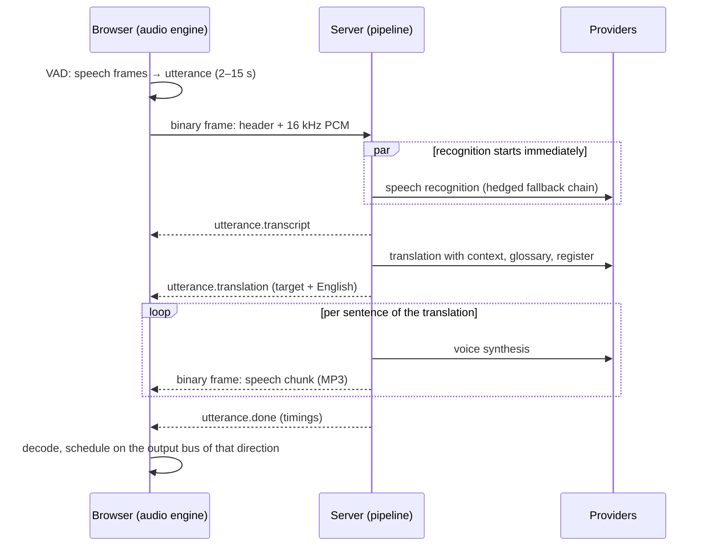

# Architecture

Tarjuman is a small Node.js server and a browser application, in one TypeScript project.

```
src/shared/   contracts used by both sides: wire protocol, settings, REST shapes, languages
src/server/   Fastify + WebSocket server: providers, fallback chains, per-call pipeline
src/web/      React application: audio capture, speech segmentation, mixing, interface
```

## The shape of the problem

A human interpreter in a call does four things: decides when a thought is complete,
understands it, says it in the other language, and stays out of the way while doing so.
The design follows the same four concerns.

1. **When is a sentence finished?** Decided in the browser, by voice activity detection.
2. **What was said, and what does it mean in the other language?** Decided on the server,
   by speech recognition and a translation model with conversation context.
3. **Say it.** A neural voice, played to the correct device.
4. **Stay out of the way.** Two fully independent directions, no feedback loops, and
   graceful behaviour when a free-tier provider says "not now".



## Why a cascade, and why sentence by sentence

There are two ways to build this: a _cascade_ (recognize → translate → speak) or an
end-to-end speech-to-speech model. The cascade is the dependable core here because every
stage can be swapped, measured and given a fallback independently, the translation step can
be steered (glossary, register, context), and English captions fall out for free. Its cost
is latency: a sentence is interpreted after it ends, typically one to three seconds later.

End-to-end streaming translation (Google's Live Translate model) removes that delay and is
the most promising next step; it is planned as a second engine behind the same interface
(see [ROADMAP.md](ROADMAP.md)), not as a replacement, because it accepts no glossary or
instructions and its free quota is not published.

## Browser

### Capture and segmentation (`src/web/src/audio`)

- `sources.ts` opens the three kinds of input: the microphone (noise suppression on, echo
  cancellation only without headphones), screen/tab sharing (all voice processing off,
  own-audio exclusion requested), and a plain input device such as a virtual cable (raw).
- `capture.ts` runs the Silero VAD model in the page (ONNX Runtime Web, via
  `@ricky0123/vad-web`, loaded on first use). The library is used only as a source of
  per-frame speech probabilities.
- `segmenter.ts` turns those probabilities into utterances. It is the part that decides how
  "live" the product feels, and it is pure logic with unit tests:
  - an utterance ends after `pauseMs` of silence (default 650 ms, user-adjustable);
  - after 9 s of continuous speech a breath (260 ms) is enough;
  - at 15 s the speech is cut at the quietest recent frame and continues in a new utterance,
    flagged as a fragment so the translator does not "complete" the sentence;
  - 320 ms of audio before the first speech frame is kept, so word onsets are not clipped.

Only audio containing speech is sent. This is what makes free speech-recognition quotas
sufficient, and it keeps recognizers from inventing text for silence.

### Output (`output.ts`)

One `OutputBus` per destination, each an `AudioContext` routed with `setSinkId`:

| Bus      | Device             | Carries                                                                |
| -------- | ------------------ | ---------------------------------------------------------------------- |
| outgoing | virtual microphone | your translation, optionally your own voice underneath                 |
| incoming | headphones         | their translation, optionally their original voice underneath (ducked) |
| monitor  | headphones         | a quiet copy of your own translation, if you want to hear it           |

Speech chunks are decoded in arrival order and scheduled back to back on the context's
clock, so playback is gapless and independent of timers. The reported queue length feeds
back to the server, which speaks faster when the interpreter falls behind.

### Feedback control (`app/controller.ts`)

A capture channel has a gate. While closed, its input is treated as silence.

- Without headphones the microphone gate closes while any translated speech is audible in
  the room, and reopens 300 ms after it ends.
- When the whole system's audio is shared and the browser cannot exclude this page's own
  audio, the incoming gate closes while Tarjuman is speaking.
- In push-to-talk mode the microphone gate is closed unless the key is held.

Nothing on this path uses timers: browsers slow timers to once per second, or minute, when
a window is hidden, and Tarjuman is by design hidden behind Teams. The gate delay is
measured against the audio frames themselves.

### State (`state/`, `ui/`)

One store (zustand). The controller is its only writer; React components read it with
narrow selectors and call controller methods. `state/types.ts` is the contract between
the two halves.

## Server

### Providers and the fallback chain (`src/server/providers`)

Three interfaces, `SttProvider`, `MtProvider`, `TtsProvider` (`types.ts`). Providers are
stateless and classify every failure as a `ProviderError` kind. `FallbackChain` (`chain.ts`)
owns everything that makes free tiers usable in a live conversation:

| Situation                 | Reaction                                                                                              |
| ------------------------- | ----------------------------------------------------------------------------------------------------- |
| No key                    | provider is skipped                                                                                   |
| Rate limited              | cooldown for the time the provider asks for, next provider answers                                    |
| Per-minute budget used up | skipped before it can answer 429                                                                      |
| Timeout or server error   | exponential cooldown, 5 s → 60 s                                                                      |
| Key rejected              | disabled until keys change                                                                            |
| Repeated "bad request"    | assumed misconfigured (retired model), rested for a minute                                            |
| Slow answer               | _hedging_: after about 2.5 s the next provider is started in parallel and the first valid answer wins |
| Everything resting        | the provider that recovers soonest is tried anyway                                                    |

Per-language preference is applied per request: for Urdu the multimodal model is tried
first, for German and English Whisper.

Because the APIs change faster than this code, the model-backed providers negotiate:
`GeminiNegotiator` walks to the next candidate model on "not found" and to a plainer
request shape on "bad request"; `OpenAiCompatMtProvider` steps from strict JSON schema to
JSON mode to plain. The first shape that works is remembered.

### One prompt (`mt/prompt.ts`)

All LLM providers use the same interpreter prompt and the same answer parser. The model
returns JSON with English first and the spoken language second; the parser rejects answers
in the wrong script, missing languages and rambling, which sends the request to the next
provider. Everything said in the meeting, the sentence being translated as well as the
earlier turns given as context, is passed as data inside delimiters that it cannot close,
and the prompt states that it is never an instruction. A model can still be talked into a
wrong translation; it cannot be talked out of the answer format.

### The pipeline (`pipeline/session.ts`)

One `InterpreterSession` per WebSocket.

```
utterance N    [ STT ]──▶[ translate ]──▶[ synthesize + send ]
utterance N+1     [ STT ]─────▶[ translate ]────▶[ synthesize + send ]
```

- Recognition starts the moment audio arrives, for all utterances in parallel.
- Translation runs in arrival order per channel (the _text lane_): each sentence is context
  for the next.
- Synthesis runs in order on a second lane, so translating sentence N+1 never waits for the
  audio of sentence N. Within an utterance, sentence _i+1_ is synthesized while _i_ is sent.
- The two channels share nothing but the conversation memory (the last few turns, in RAM
  only), so one direction cannot hold up the other.
- Every failure becomes exactly one event for that utterance. A voice failure still
  delivers the caption.

Before anything is spoken, `hallucination.ts` checks the transcript: Whisper's own
no-speech rule, a confidence floor, repetition loops, known artefacts ("Untertitel der
Amara.org-Community"), wrong script for the channel, an echoed prompt, stock phrases on
weak audio, and more text than the audio could hold. The patterns are deliberately narrow,
because this tool is used to talk about subtitles and translation.

### Transport and security (`http/`)

- JSON text frames for events; binary frames (`[length][JSON header][payload]`) for audio in
  both directions. Everything from the browser is validated before it reaches the pipeline.
- The server listens on 127.0.0.1 by default. A local server is reachable by every web page
  the user visits, so requests are checked for same origin and for a loopback `Host`
  (against cross-site requests and DNS rebinding).
- Any other listen address requires `ACCESS_TOKEN`; the server refuses to start without it.
- API keys live on the server (environment first, then `data/keys.json`, mode 0600) and are
  never sent to the browser; only masked hints are.
- The page is served with a strict Content-Security-Policy and loads nothing from third
  parties: fonts, the VAD model and the ONNX runtime are bundled.
- Transcripts and translations are not logged unless `LOG_TRANSCRIPTS=1`; request URLs are
  logged without their query string.
- Behind a reverse proxy the Host header no longer identifies the site, so `PUBLIC_ORIGIN`
  names the one origin requests may come from.

## Decisions and their reasons

| Decision                                       | Reason                                                                                                                                                                        |
| ---------------------------------------------- | ----------------------------------------------------------------------------------------------------------------------------------------------------------------------------- |
| Browser + virtual cable instead of a Teams bot | A bot that receives call audio must be a C#/.NET service on Windows in Azure with tenant-admin consent. The browser route needs no permissions from anyone and costs nothing. |
| Speech detection in the browser                | Saves quota and bandwidth, keeps silence away from recognizers, and makes endpointing tunable per user.                                                                       |
| Own segmenter on top of the VAD library        | The library has no maximum segment length and no adaptive pause, both essential for interpreting monologues.                                                                  |
| Multimodal model for Urdu recognition          | Published comparisons show Whisper at 20–50 % word error rate on Urdu (worse with English terms mixed in), an order of magnitude behind Gemini. One call also replaces two.   |
| LLM translation instead of classic MT          | The input is imperfect recognizer output. An LLM repairs it from context, keeps names and terms, and controls the form of address.                                            |
| Edge read-aloud voices by default              | The only keyless source of natural Urdu voices. Azure AI Speech (same voices, official) is the configured upgrade and is preferred automatically once a key is present.       |
| Hedged requests                                | A slow answer hurts a live conversation more than a failed one; a second request costs little.                                                                                |
| Single package, shared contracts               | One install, one build, and the protocol cannot drift between client and server.                                                                                              |
| No database                                    | Settings live in the browser, keys in one file, transcripts only on screen until exported. Nothing to leak, nothing to migrate.                                               |

## Testing

| Layer                                                    | How                                                                                                                                          |
| -------------------------------------------------------- | -------------------------------------------------------------------------------------------------------------------------------------------- |
| Pure logic (segmenter, chain, filters, prompt, protocol) | Vitest unit tests                                                                                                                            |
| Providers                                                | Vitest with an injected `fetch`; the Edge voice against a local WebSocket stand-in; tokens against vectors from the reference implementation |
| Server                                                   | Vitest against the real app on a real socket, with mock providers                                                                            |
| Everything together                                      | Playwright: real Chromium, recorded German speech as the microphone, mock providers                                                          |
| Real providers                                           | `npm run doctor`, with your keys                                                                                                             |
