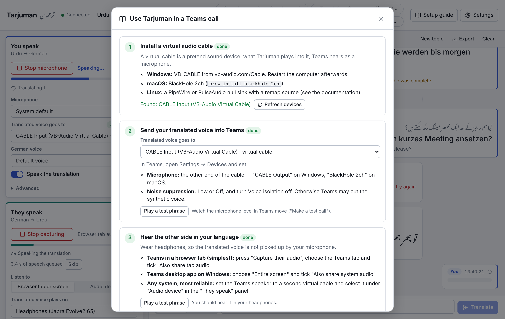

# Using Tarjuman in a Microsoft Teams call

Tarjuman runs next to Teams on your computer. Two things have to be connected:

| Direction      | From                        | To                                                  |
| -------------- | --------------------------- | --------------------------------------------------- |
| **You speak**  | your microphone → Tarjuman  | a _virtual cable_ that Teams uses as its microphone |
| **They speak** | the call's audio → Tarjuman | your headphones                                     |

The same steps are in the app under **Setup guide**, with live checks and test buttons.



Use **Chrome** (version 141 or newer is best) on a computer. Edge works for most of it.
Wear **headphones**.

---

## 1. Install a virtual audio cable

A virtual cable is a pretend sound device with two ends: what one program plays into it,
another program can record from it.

### Windows

1. Download **VB-CABLE** from <https://vb-audio.com/Cable/>, unzip it, right-click
   `VBCABLE_Setup_x64.exe` → _Run as administrator_ → _Install Driver_.
2. Restart the computer.
3. You now have a playback device **CABLE Input (VB-Audio Virtual Cable)** and a recording
   device **CABLE Output (VB-Audio Virtual Cable)**.

VB-CABLE is donationware. Its licence asks companies and other organisations to pay what
they consider fair; nothing in the software enforces it.

Windows may switch your default speaker to the cable after installation. If you suddenly
hear nothing, set your headphones as the default output again (Settings → System → Sound).

### macOS

```bash
brew install blackhole-2ch
```

(or the installer from <https://existential.audio/blackhole/>). The device is called
**BlackHole 2ch** and is both the playback and the recording end. BlackHole is free.

### Linux (PipeWire or PulseAudio)

Chrome does not list "monitor" sources, so each cable is a null sink plus a remap source:

```bash
pactl load-module module-null-sink sink_name=tarjuman_mic sink_properties=device.description=Tarjuman-Mic
pactl load-module module-remap-source master=tarjuman_mic.monitor source_name=tarjuman_mic_src source_properties=device.description=Tarjuman-Mic-Source
```

Tarjuman plays into **Tarjuman-Mic**; Teams uses **Tarjuman-Mic-Source** as its microphone.
The modules disappear on reboot unless you add them to your PipeWire/PulseAudio configuration.

### Check

Open the setup guide in the app. Step 1 lists the virtual devices it found. If device
names are hidden, press **Show device names** and allow microphone access.

---

## 2. Send your translated voice into Teams

**In Tarjuman** (panel _You speak_):

- **Microphone**: your real microphone or headset.
- **Translated voice goes to**: the cable's playback end, i.e. _CABLE Input_, _BlackHole 2ch_
  or _Tarjuman-Mic_. A green "virtual cable" badge appears.

**In Teams** → _Settings and more (…)_ → _Settings_ → _Devices_:

- **Microphone**: the cable's recording end, i.e. _CABLE Output_, _BlackHole 2ch_ or
  _Tarjuman-Mic-Source_.
- **Noise suppression**: _Low_ or _Off_.
- **Voice isolation**: off. It keeps only your enrolled voice and removes a synthetic one.
- **Automatically adjust mic sensitivity**: off.

**Test it.** In the setup guide press **Play a test phrase** under step 2 while Teams shows
its microphone level (_Make a test call_ is ideal). The level must move, and the test call
must play the phrase back.

From now on the people in the call hear the German voice instead of your own. If you want
them to hear you quietly underneath, as with a human interpreter, raise
_Advanced → Let them hear my own voice underneath_ to about 10–15 %.

---

## 3. Let Tarjuman hear the other side

Pick the option that matches how you run Teams.

### A. Teams in a browser tab (simplest, works on every system)

1. Join the meeting at <https://teams.microsoft.com> in a Chrome tab.
2. In Tarjuman (panel _They speak_) keep **Browser tab or screen** selected and press
   **Capture their audio**.
3. In Chrome's dialog choose the **Chrome Tab** with Teams and make sure
   **Also share tab audio** is ticked. Press _Share_.

Only audio is used; nothing is recorded or sent as video. A tab contains only the other
participants' voices, so there is no risk of Tarjuman hearing itself.

You will hear the original German from the Teams tab and the Urdu voice from Tarjuman at
the same time. Either lower the volume in Teams, or switch on _Advanced → Mute the captured
tab itself_ before capturing: the tab goes silent, and Tarjuman replays the original at the
volume you set, lowered automatically while the translation is spoken.

### B. Teams desktop app on Windows

1. Press **Capture their audio**.
2. Choose **Entire screen** and tick **Also share system audio**.

Everything your computer plays is now heard by Tarjuman. On Windows 11 with a current
Chrome, Tarjuman's own voice is left out automatically. On older systems it is not, and
Tarjuman pauses listening while its translation plays (you will see "Paused while the
translation plays"). Keep notification sounds and music off.

This option is not available on Linux, and on macOS only from version 14.2.

### C. Any system, most reliable: a second virtual cable

1. Install a second cable (Windows: _VB-Audio Hi-Fi Cable_ or _VB-CABLE A+B_; macOS:
   `brew install blackhole-16ch`; Linux: a second null sink with remap source).
2. In Teams → Settings → Devices set **Speaker** to that second cable. Never use the same
   cable for the microphone and the speaker.
3. In Tarjuman (panel _They speak_) choose **Audio device** and select the second cable's
   recording end.
4. Set _Advanced → Original voice volume_ to taste. Because the call no longer reaches your
   headphones directly, Tarjuman replays it for you underneath the translation.

No sharing dialog, nothing to re-approve at every call, and no way for sounds to mix.

### Then

- **Translated voice plays on**: your headphones.
- Press **Play a test phrase** under step 3 of the setup guide: you should hear it there.

---

## 4. During the call

- Press **Start microphone** and **Capture their audio**. Both stay on for the whole call.
- Speak a sentence, pause briefly. The entry in the transcript shows your words, the German
  translation and English; the small number is the delay until the voice started.
- If translated speech piles up ("x s of speech queued"), press **Skip** to jump to now.
- Type in the box at the bottom when a name or number must be exact.
- **New topic** clears the conversation memory when the subject changes completely.
- **Export** saves the transcript as Markdown, text or JSON: instant meeting notes.

Keep the Tarjuman window open (it may be behind Teams, but do not minimise it or close
the tab), and choose _Allow while visiting the site_ when Chrome asks about the microphone.

---

## If something does not work

| Symptom                                                         | Cause and fix                                                                                                                                                                |
| --------------------------------------------------------------- | ---------------------------------------------------------------------------------------------------------------------------------------------------------------------------- |
| The Teams microphone level does not move during the test phrase | "Translated voice goes to" is not the cable, or the Teams microphone is not the cable's other end. On Windows the pair is _CABLE Input_ (Tarjuman) ↔ _CABLE Output_ (Teams). |
| The others hear a chopped or robotic voice                      | Teams noise suppression or voice isolation. Set them to Low/Off as above.                                                                                                    |
| The others hear the translation twice or with echo              | Your real microphone is still selected in Teams, or you use loudspeakers. Select the cable in Teams and wear headphones.                                                     |
| "Nothing to listen to: the share did not include audio"         | The audio box in the sharing dialog was not ticked. Capture again.                                                                                                           |
| Tarjuman translates its own Urdu voice back into German         | The translated voice reaches your microphone. Wear headphones, or switch off _Settings → Audio → I am using headphones_.                                                     |
| German and Urdu voices overlap                                  | Lower the Teams volume or use _Mute the captured tab itself_ (option A) or option C.                                                                                         |
| No device names in the lists                                    | Press _Show device names_ and allow the microphone.                                                                                                                          |
| It stops when I switch to the Teams window                      | The Tarjuman window was minimised, or the tab was discarded. Keep it open in its own window.                                                                                 |
| After a Windows update the cable is gone                        | Reinstall VB-CABLE as administrator and restart.                                                                                                                             |
